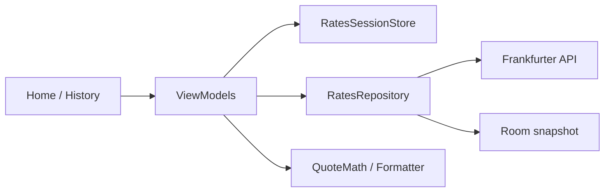

# Câmbioo

**App Android de leitura rápida de câmbio em reais** — cotação honesta, histórico de 30 dias e offline a partir do último snapshot.

> Portfólio de engenharia Android (Kotlin + Jetpack Compose). Escopo fechado da v1, com decisões documentadas e testes JVM nas regras de domínio e ViewModels.

[](https://kotlinlang.org/)
[](https://developer.android.com/)
[](https://developer.android.com/jetpack/compose)
[](#)

---

## Por que este projeto existe

Consultar câmbio no celular costuma misturar ruído visual, data ambígua e “queda” inventada em fim de semana. O Câmbioo resolve um uso objetivo: **olhar o número em reais, a variação e a data — em poucos segundos**, inclusive sem rede.

Para quem avalia o repositório como peça de portfólio, o valor está na forma de construção: **MVVM + Compose, rede tipada, snapshot local, domínio puro testável e acessibilidade como requisito**, num único módulo `:app`, sem backend próprio.

## O que a v1 faz

| Capacidade | Detalhe |
| --- | --- |
| Quatro moedas | USD, EUR, GBP e CHF — sempre nessa ordem, valor em BRL |
| Variação honesta | Contra a observação **publicada** imediatamente anterior (sem interpolar feriado/fim de semana) |
| Histórico | Janela de 30 dias corridos, só dias publicados |
| Offline de leitura | Último snapshot bem-sucedido no Room; falha de rede não apaga dado bom |
| Estados claros | Carregando, conteúdo, vazio, erro sem snapshot, conteúdo + aviso |
| Acessibilidade | TalkBack anuncia valor por extenso (“dólar, 5 reais e 42 centavos”) **uma vez** |
| Fonte nomeada | Banco Central Europeu, via [Frankfurter](https://frankfurter.dev/) — não se passa por PTAX |

**Fora da v1 (de propósito):** gráfico, conversor, PTAX, mais moedas, conta, push, widget.

## Destaques de engenharia

O que um recrutador técnico costuma procurar — e onde aparece neste repo:

- **Arquitetura legível:** MVVM com `StateFlow`, UI Compose coletando com `collectAsStateWithLifecycle`, repositório como fronteira de dados.
- **Domínio puro:** inversão de taxa, janela de datas e variação em `BigDecimal` (`HALF_UP`, escala 2) — **sem `Double`** na cotação.
- **Uma chamada por atualização:** série ECB/Frankfurter v2 para as quatro moedas no intervalo; sem “latest” extra.
- **Offline consciente:** Room substitui o snapshot de forma atômica; pull/retry compartilham a mesma carga (`RatesSessionStore`).
- **Testes JVM:** domínio, formatador falado, repositório (fakes), ViewModels (Turbine + coroutines-test).
- **A11y no produto:** `clearAndSetSemantics` para não duplicar o número visual no TalkBack.
- **Documentação de produto:** brief → PRD com specs → architecture (papéis separados, sem redundância).

## Arquitetura

```text
UI (Compose)  →  ViewModel (StateFlow)  →  RatesRepository
                                              ├─ Retrofit (Frankfurter ECB)
                                              └─ Room (snapshot)
                         ↑
                   domain/ (JVM puro)
```



Pacotes sob `com.amdcruz.cambioo`:

```text
di/            Hilt
data/remote/   Retrofit, DTO, API
data/local/    Room
data/          contrato e implementação do repositório
domain/        modelos, inversão, variação, formatador acessível
ui/home/
ui/history/
ui/components/
ui/theme/
ui/common/     sessão de refresh e anúncios TalkBack
```

Detalhes: [`docs/architecture.md`](docs/architecture.md).

## Stack

| Camada | Tecnologia |
| --- | --- |
| Linguagem | Kotlin |
| UI | Jetpack Compose, Material 3, Navigation Compose |
| Assíncrono | Coroutines, Flow / StateFlow |
| DI | Hilt |
| Rede | Retrofit, OkHttp, kotlinx.serialization |
| Local | Room |
| Testes | JUnit, MockK, Turbine, kotlinx-coroutines-test |
| Build | Gradle Kotlin DSL, Version Catalog, KSP |

- **minSdk** 26 · módulo único `:app` · permissão: apenas `INTERNET`

## Como rodar

### Pré-requisitos

- Android Studio recente (AGP 9.x / JDK alinhado ao projeto)
- Emulador ou aparelho com API 26+
- Rede para a primeira carga (depois o snapshot cobre leitura offline)

### Build e instalação

```bash
./gradlew :app:assembleDebug
./gradlew :app:installDebug
```

No Windows (PowerShell), use `.\gradlew.bat` no lugar de `./gradlew`.

Abra o app: a home dispara a carga da janela; toque numa moeda para o histórico; puxe a lista para atualizar.

### Testes

```bash
./gradlew :app:testDebugUnitTest
```

## Screenshots / demo

> Espaço reservado para capturas da home, histórico e estados (erro / offline).  
> Sugestão: adicione PNGs em `docs/images/` e referencie aqui — recrutadores valorizam ver a UI sem abrir o Android Studio.

```text
docs/images/
  home.png
  history.png
  offline-notice.png
```

## Documentação do produto

| Documento | Papel |
| --- | --- |
| [`docs/product-brief.md`](docs/product-brief.md) | Visão e público |
| [`docs/prd/cambioo.md`](docs/prd/cambioo.md) | Specs, regras e aceite (v1 **Implementada**) |
| [`docs/architecture.md`](docs/architecture.md) | Stack, API, Room, pacotes, testes |
| [`docs/design/style-reference.md`](docs/design/style-reference.md) | Inspiração visual (não redefine escopo) |
| [`docs/README.md`](docs/README.md) | Índice da pasta `docs/` |

Roteiro manual de verificação (7 passos): Spec 09 no [PRD](docs/prd/cambioo.md).

## Branching (resumo)

- `main` — linha estável / release
- `develop` — integração da v1
- `feature/phase-*` — entregas por fase (domínio → dados → home → histórico → a11y)

## Autor

**Alisson Cruz** · engenharia de software / Android  

Repositório: [github.com/AlissonMdaCruz/cambioo](https://github.com/AlissonMdaCruz/cambioo)

---

*Câmbioo — câmbio do dia, em reais. Leitura rápida, número honesto, último snapshot disponível sem rede.*
